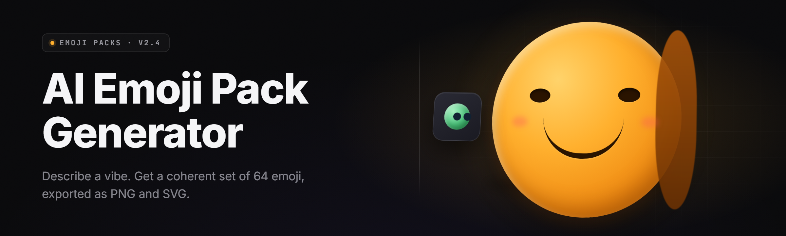

  
  
  

  

  
  

---

**Generate, remix, and export full emoji packs from a single prompt — offline, on Windows, no cloud round-trip.**

---

## 📦 Comparison — Aspect | Alternative | This Tool

A quick look at how the AI Emoji Pack Generator compares against the usual routes people take when they need a batch of emoji assets.

| Aspect | Alternative | This Tool |
|---|---|---|
| **Setup** | Cloud web app, account required | Portable `.exe`, no login |
| **Cost model** | Per-image credits / subscription | One-time download, unlimited local runs |
| **Offline use** | None — needs a browser + connection | Fully offline after first model unpack |
| **Pack export** | Manual download, one emoji at a time | One-click `.zip` pack (Slack/Discord/Telegram layouts) |
| **Style consistency** | Re-prompt and hope | Seeded style lock across the whole pack |
| **Bulk generation** | Rate-limited queues | Batched on-device, GPU-accelerated |
| **Format coverage** | PNG only | PNG, WebP, APNG, `.emoji.json` manifest |
| **Privacy** | Prompts logged server-side | Nothing leaves the machine |

The alternative isn't bad — it's just built around a server. This tool is built around your desk.

---

## 🗂 Table of Contents

- [📦 Comparison — Aspect | Alternative | This Tool](#-comparison--aspect--alternative--this-tool)
- [🧭 Usage guidelines — Allowed | Not allowed](#-usage-guidelines--allowed--not-allowed)
- [📖 What is an AI Emoji Pack Generator — Term | Explanation](#-what-is-an-ai-emoji-pack-generator--term--explanation)
- [🖥 Compatibility / platform support table](#-compatibility--platform-support-table)
- [🧩 Overview — Category | Details](#-overview--category--details)
- [🔧 Key Features — Feature | Description | Benefit](#-key-features--feature--description--benefit)
- [🩹 The Problem — niche pain-point bullets](#-the-problem--niche-pain-point-bullets)
- [🧪 The Solution — Problem | Solution](#-the-solution--problem--solution)
- [⚙ Quick Start — numbered steps](#-quick-start--numbered-steps)
- [🎨 Style & Generation Modules](#-style--generation-modules)
- [📤 Export & Pack Modules](#-export--pack-modules)
- [🤖 Prompt & Model Modules](#-prompt--model-modules)
- [🗃 Asset Management Modules](#-asset-management-modules)
- [🧵 Workflow & Automation Modules](#-workflow--automation-modules)
- [🧷 Hotkeys](#-hotkeys)
- [🧰 System Requirements — Component | Minimum | Recommended](#-system-requirements--component--minimum--recommended)
- [🛠 Installation — numbered sub-steps](#-installation--numbered-sub-steps)
- [🧯 Known Issues — Issue | Fix](#-known-issues--issue--fix)
- [💬 FAQ — Question | Answer](#-faq--question--answer)
- [⬇ Download (2026 Release)](#-download-2026-release)

---

## 🧭 Usage guidelines — Allowed | Not allowed

The generator is a creative tool. Here's where the line sits, plainly.

| Allowed | Not allowed |
|---|---|
| Generating original emoji packs from your own prompts | Generating packs impersonating a living person's face or brand logo |
| Remixing your own source artwork into emoji sets | Reselling packs built from a third party's copyrighted sprites |
| Exporting packs for Slack, Discord, Telegram, Matrix | Using the tool to produce hate symbols or targeted harassment assets |
| Commercial use of packs you generated and own | Bundling the tool's default model weights into a paid product |
| Training your own LoRA on top of the base model | Scraping platform APIs to bulk-download other people's packs |
| Sharing your generated `.zip` packs publicly | Claiming the tool generated artwork you actually drew by hand |

> **Note:** "You generated it" means the prompt, seed, and style parameters were yours. Credit where it's due.

---

## 📖 What is an AI Emoji Pack Generator — Term | Explanation

| Term | Explanation |
|---|---|
| **Emoji Pack** | A directory of images plus a manifest describing shortcodes, names, and platform metadata. |
| **Seed Lock** | A fixed random seed + style vector applied across every image in a pack so the set reads as one family. |
| **Tile** | A single emoji at native output size, usually 128×128 or 512×512 before platform downscale. |
| **Shortcode** | The `:name:` token a chat platform renders to the image, e.g. `:potato_hype:`. |
| **Manifest** | The `.emoji.json` file listing every tile, its shortcode, and suggested tags. |
| **Refiner Pass** | A second diffusion step that sharpens edges and cleans transparency after the base generation. |
| **Style Vector (LoRA)** | A small adapter that pushes the base model toward a specific art style — flat, glossy, pixel, crayon. |
| **Batch Queue** | The on-device job list; you can enqueue 200 tiles and walk away while it renders. |

Six concrete wins from a tool that respects the word "pack":

- One prompt produces a consistent set — not one lucky image and forty randoms.
- Shortcodes are auto-generated from tile content, so you're not hand-labeling 60 files.
- Export presets match the exact pixel and manifest rules each platform expects.
- Everything runs locally, so a client's unreleased brand never touches a cloud box.
- Seeds and style vectors are portable; a colleague can reproduce your pack byte-for-byte.
- The `.zip` is drag-and-drop-ready for Slack, Discord, and Telegram admin panels.

---

## 🖥 Compatibility / platform support table

Which platforms the generator can target on export, and how each one is handled.

| Platform | Emoji Asset | Manifest / Layout | Notes |
|---|---|---|---|
| 🎮 Discord | 128×128 PNG / APNG | `emoji.json` | Animated APNG supported on Nitro-tier servers |
| 💬 Slack | 128×128 PNG | `manifest.json` | Workspace emoji limit ~50k; tool warns at pack size |
| 📨 Telegram | 100×100 PNG, 512×512 sticker | `sticker_set.json` | Sticker format is separate from emoji upload |
| 🟦 Matrix | 256×256 PNG / WebP | `m.emote` event fields | Homeserver limits vary; tool shows target server caps |
| 🐘 Mastodon | 128×128 PNG / APNG | `custom_emojis.json` | Best paired with admin import |
| 🖼 Streamlabs | 512×512 WebP | `emote_manifest.json` | Includes sub-emote variants |
| 🎥 OBS Overlay | Any size PNG | PNG sequence | No manifest — raw files for scene sources |
| 🍎 iMessage | 64×64 PNG | Sticker pack plist | Requires Mac-side import tool |

---

## 🧩 Overview — Category | Details

| Category | Details |
|---|---|
| **App type** | Portable Windows desktop `.exe`, no installer, no admin rights needed |
| **Generation engine** | Local diffusion model, ONNX + DirectML accelerated, CPU fallback |
| **Model size** | ~1.9 GB unpacked on first run |
| **Output formats** | PNG, WebP, APNG, SVG-in-PNG, `.emoji.json` manifests |
| **Default tile size** | 128×128, 256×256, 512×512, or custom square |
| **Batch capacity** | Up to 512 tiles per session before RAM pressure rises |
| **Distribution** | Landing page → download → extract → run the `.exe` |

This is a small tool that does one job end-to-end: you describe a mood, a mascot, a theme, or a set of expressions, and it produces a coherent emoji pack with the manifests already written. No model-hosting accounts, no per-image billing, no upload step. You keep the files.

---

## ⬇ Download

  

Grab the current release archive, extract it anywhere (**avoid Program Files** — the folder wants to write its model cache next to itself), and double-click the `.exe`. First launch unpacks the bundled model weights; after that, launches are instant.

---

## 🔧 Key Features — Feature | Description | Benefit

| Feature | Description | Benefit |
|---|---|---|
| **Style Lock** | Fixes seed + style vector across the whole pack | Every tile looks like part of the same family |
| **Shortcode Autogen** | Reads tile content and proposes `:name:` tokens | No hand-labeling a 60-file pack |
| **Refiner Pass** | Cleanup stage that fixes edges and alpha | Crisp at 32–64 px where chat renders most emoji |
| **Batch Queue** | Enqueue up to 512 tiles, walk away | Turns a 90-minute job into a coffee break |
| **Multi-Platform Export** | Discord, Slack, Telegram, Matrix, Mastodon presets | One pack, several destinations |
| **APNG Authoring** | Frame-sequences animated emoji | Animated sets without external tools |
| **Prompt Scaffolding** | Expression matrices: happy/sad/mad × 8 poses | Fills a pack's emotional range fast |
| **Pack Diffing** | Compares two packs for visual drift | Keeps sequel packs on-model |
| **Local-Only** | No network calls after model unpack | Client work never leaves the machine |
| **Model Swapping** | Drop your own LoRA into `/models/loras` | Push the tool toward any art style |
| **Tile Cleaner** | Auto-removes stray marks outside the emoji bounds | Less manual retouching |
| **Manifest Exporters** | Per-platform JSON writers | Drag-and-drop into admin panels |

---

## 🩹 The Problem — niche pain-point bullets

People making emoji packs run into the same wall over and over.

- **Style drift.** You generate fifty emojis and they arrive in fifty slightly different art styles — some with thick outlines, some soft, none matching.
- **Shortcode tedium.** Chat platforms need a shortcode per tile. Naming sixty files by hand is a quiet nightmare.
- **Platform manifest rules.** Discord wants one JSON shape, Slack wants a different one, Telegram wants `sticker_set.json`, Mastodon wants another. You find out at 2 a.m.
- **Animated sets need a second tool.** Distinguishing between a "frame sequence" and an "animated emoji" and a "sticker" eats an hour before you've drawn a pixel.
- **Cloud generators leak prompts.** If the client mascot isn't public yet, uploading it to a web app is a non-starter.
- **Re-running for consistency is guesswork.** Without fixed seeds, regenerating the set gives you a different family every time.
- **Downscale destroys detail.** Naive export at 128 px turns glossy eyes into flat smudges.

---

## 🧪 The Solution — Problem | Solution

| Problem | Solution |
|---|---|
| Style drift across the pack | Style Lock: fixed seed + LoRA vector applied to every tile |
| Shortcode tedium | Shortcode Autogen proposes and dedupes `:name:` tokens |
| Platform manifest rules | Built-in exporters for each platform's JSON shape |
| Animated emoji overhead | APNG Authoring with frame-sequence preview |
| Cloud prompt leakage | Fully local model — nothing leaves the machine |
| Reproducibility | Seeds and style vectors exported in the pack's `.emoji.json` |
| Downscale artifacts | Refiner Pass + tile-cleaning pipeline before export |

---

## ⚙ Quick Start — numbered steps

Four steps, end to end.

1. 📥 **Download and extract.** Get the archive from the release page, extract it to a normal folder (not `Program Files`, not `System32`, not your desktop — a folder you can actually find).
2. ⚙ **Run the `.exe`.** First launch unpacks the bundled model. Expect ~1.9 GB to land in the app's `models/` directory. This happens once.
3. ✍ **Describe your pack.** Type a prompt like `flat-glossy cartoon potato mascot, 12 expressions` and pick a platform from the export dropdown.
4. 🚀 **Generate and export.** The queue renders each tile, the refiner cleans edges, and the exporter produces the `.zip` with manifests already written.

That's the whole flow. Everything below is detail.

---

## 🎨 Style & Generation Modules

**Flat Style Engine** — Vector-flat output with uniform stroke weight. Pairs best with 128×128 tiles.
**Glossy Style Engine** — High-saturation shading with soft speculars. Loves 256×256.
**Pixel Style Engine** — 16/24/32-color palettes with nearest-neighbor export.
**Crayon Style Engine** — Hand-drawn wobble, paper texture, off-white backgrounds.
**Isometric Style Engine** — 30° rotation, consistent light source across the pack.
**Anime Cel Engine** — Two-tone shading, hard light/shadow edges.
**Sticker-Outline Engine** — Auto white/black border around every tile for Telegram.

---

## 📤 Export & Pack Modules

**Discord Exporter** — Emits `emoji.json`, 128×128, APNG for animated tiles.
**Slack Exporter** — `manifest.json` with workspace-size warnings.
**Telegram Exporter** — Splits into emoji set and sticker set, correct sizes.
**Matrix Exporter** — `m.emote` metadata, WebP option.
**Mastodon Exporter** — APNG-tolerant, admin-import bundle.
**Streamlabs Exporter** — 512×512 WebP with sub-emote variants.
**PNG-Sequence Exporter** — Raw frames for OBS overlays.
**iMessage Exporter** — Plist-format sticker pack for Mac import.
**Pack Zipper** — Collapses the export directory, manifest included, timestamped.
**Checksum Writer** — `SHA256SUMS` file for release-style distribution.

---

## 🤖 Prompt & Model Modules

**Prompt Templates** — Built-in scaffolding for expression matrices, character sheets, and reaction sets.
**LoRA Loader** — Drop a `.safetensors` file into `/models/loras`, restart the app.
**Seed Manager** — Save, load, and share seeds across sessions.
**Negative Prompt Editor** — Maintain a pack-wide negative list.
**Style Vector Exporter** — Saves the exact style parameters for reproducibility.
**Refiner Model Swap** — Use a different refiner than the base if you want sharper or softer edges.
**Batch Prompt Matrix** — Fill a grid of prompts × seeds for rapid iteration.

---

## 🗃 Asset Management Modules

**Tile Library** — Local cache of every generated tile, deduplicated by hash.
**Pack Browser** — Thumbnails + shortcodes + tags for every pack you've made.
**Snippet Vault** — Save frequently used prompts and shortcode patterns.
**Emoji Tagger** — Auto-tag tiles with content descriptors.
**Duplicate Finder** — Flags two tiles that differ only by noise.
**Version Diffing** — Compare v1 and v2 packs side-by-side.
**Pack Merger** — Combines two packs into one, deduping by hash.

---

## 🧵 Workflow & Automation Modules

**Batch Queue** — Drag the whole job to the queue, hit start, walk away.
**Preset Workflows** — "Discord pack from mascot", "Slack long-tail emoji", "Nitro animated set."
**CLI Mode** — `.exe` accepts `--prompt`, `--out`, `--count` for scripting.
**Watch Folder** — Drop a text file of prompts, the app picks it up and runs.
**Post-Export Hook** — Trigger an external script after zipping.
**Session Log** — JSON log of every generation with seed and parameters.
**Auto-Recovery** — Resume an interrupted batch from the last completed tile.

---

## 🧷 Hotkeys

| Hotkey | Action |
|---|---|
| `Ctrl + N` | New pack |
| `Ctrl + O` | Open existing pack |
| `Ctrl + S` | Save pack state (seeds, prompts, manifests) |
| `Ctrl + Enter` | Queue current prompt |
| `Ctrl + Shift + Enter` | Queue the whole prompt matrix |
| `Ctrl + R` | Re-run last generation with a new random seed |
| `Ctrl + Shift + R` | Re-run with the same seed (reproduce exactly) |
| `Ctrl + E` | Export current pack |
| `Ctrl + D` | Open tile directory in Explorer |
| `F5` | Refresh tile library |
| `F9` | Toggle Refiner Pass on/off |

---

## 🧰 System Requirements — Component | Minimum | Recommended

| Component | Minimum | Recommended |
|---|---|---|
| **OS** | Windows 10 64-bit | Windows 11 22H2 or newer |
| **CPU** | 4-core x86-64 (AVX2) | 8-core modern (AVX-512 helps) |
| **RAM** | 8 GB | 16 GB+ |
| **GPU** | DirectML-compatible, 4 GB VRAM | DirectML-compatible, 8 GB+ VRAM |
| **Storage** | 4 GB free | 10 GB free (tile library grows) |
| **Display** | 1280×720 | 1920×1080 or higher |
| **Network** | None required after first model unpack | Optional — used only for update checks |

CPU-only runs work; they're just slow. Expect ~12 s per 128×128 tile on a modern 8-core vs ~2 s on a 3060-class GPU.

---

## 🛠 Installation — numbered sub-steps

### 1. Download the release archive

  

The archive is a plain `.zip`. No installer, no admin prompt, no registry writes.

### 2. Extract to a normal folder

Right-click → **Extract All**. Pick somewhere like `D:\Tools\AIEmojiGen`. If you extract into `Program Files`, the app's model cache and tile library will fight you for write access. Don't.

### 3. Run the `.exe`

Double-click the executable. First launch does three things: creates `models/`, unpacks the bundled diffusion weights (~1.9 GB), and generates an empty tile library. After that, launches take two seconds.

---

## 🧯 Known Issues — Issue | Fix

| Issue | Fix |
|---|---|
| First launch is slow / appears frozen | It's unpacking the model. Check Task Manager — disk should be busy. |
| DirectML GPU not detected | Update GPU drivers; NVIDIA needs 470+ or newer, AMD wants recent Adrenalin. |
| Tile edges look soft at 32 px | Enable Refiner Pass and re-run the export. |
| APNG tiles not animating on Discord | Server tier matters — animated emoji need Nitro-tier. |
| "Access denied" on export | You extracted into a protected folder; move the app to a user-writable directory. |
| Batch queue stalls at tile 300+ | RAM pressure — drop batch size or close the tile library preview window. |

---

## 💬 FAQ — Question | Answer

| Question | Answer |
|---|---|
| Does the tool need internet access after setup? | No. Everything runs locally. Network is only used if you enable the optional update checker. |
| Can I use my own base model? | Yes — drop a `.safetensors` LoRA into `models/loras` and pick it from the model dropdown. |
| Are generated packs commercial-usable? | Packs you generated from your own prompts and style vectors are yours. The bundled base model's license governs the model itself. |
| How big can a pack be? | Tested stable at 512 tiles. Beyond that, memory pressure grows; increasing batch size helps. |
| Can I reproduce someone else's pack? | Yes — if they share their `.emoji.json` with seeds and style vectors, you can regenerate identically. |
| Does it support animated emoji? | Yes — APNG authoring is built in, frame-by-frame, with preview. |
| What image formats are supported? | PNG, WebP, APNG on the output side; PNG/JPG/WebP on input for remixing existing art. |
| Can I run it on a Mac or Linux? | Not officially. The shipping build is Windows-only. WINE has been reported to partially work. |
| Where does the tool store my packs? | In the folder you extracted to, under `packs/`. Nothing is written to `AppData` or the registry. |

---

## ⬇ Download (2026 Release)

  

2026 release. Extract anywhere user-writable, run the `.exe`, and let it unpack the model on first launch. Everything after that is local — packs, manifests, seeds, and exports all land where you extracted the archive, and nowhere else. No accounts. No cloud round-trip. Your prompts stay on your machine, in a `.zip` you built yourself.
